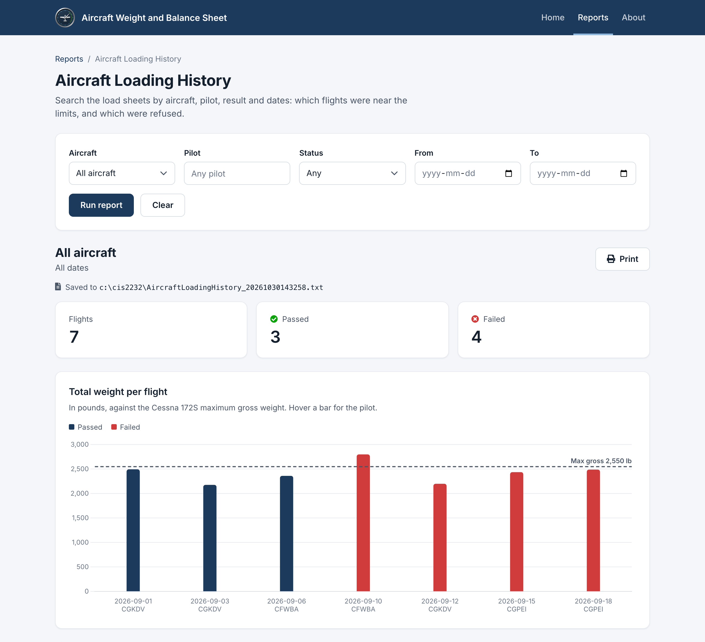

# Project: Aircraft Weight and Balance Sheet #

---
## Development Team ##
Business Client:  Ben Proulx
 
Lead Developer:  Kody Verhulp
 
Quality Control:  Nick Brown
 

---
## Description ##
This project will be used to record and check the weight and balance of a small aircraft before each flight.

Every flight in a light aircraft begins with a weight and balance calculation. The pilot has to prove two things: that the loaded aircraft is under its maximum takeoff weight, and that its centre of gravity falls inside the envelope the manufacturer approved. An aircraft over gross weight will not climb as certified. One loaded outside its centre of gravity range can be unrecoverable in a stall even when it is under weight. The check is required before every flight and is normally done by hand on a paper form at the flight school desk.

The system serves a flying club operating a single aircraft type, the Cessna 172S. One record is created per flight. The pilot enters the date, the tail number, their own name, the aircraft's empty weight and empty arm taken from its current weight and balance record, the weight in the front seats, the weight in the rear seats, the baggage weight, and the fuel loaded in US gallons.

From those entries the system works out the loaded weight and the centre of gravity, compares both against the aircraft's limits, and returns a pass or fail with the reason for any failure. It also reports how much useful load is left and how much more fuel could be carried without going over gross weight, which is the question a pilot actually asks when a fourth passenger turns up at the hangar.

Stored sheets give the club a history: which aircraft are habitually loaded near their limits, which flights were refused and why, and a record that the check was performed. Members can copy a previous sheet forward rather than re-entering the same aircraft data every time.

---
## Color ##
Base Color:  #1B3A5C (aviation navy) 
Secondary Color:  #8FB8DE (light blue) 

---
## Required Fields ##

| Field | Type | Description |
|---|---|---|
| loadSheetId | int | Unique id for the load sheet, not user entered |
| flightDate | String | Date of the flight (yyyy-MM-dd) |
| tailNumber | String | Aircraft registration, e.g. CGABC |
| pilotName | String | Name of the pilot in command |
| emptyWeight | double | Empty weight of the aircraft in lb |
| emptyArm | double | Empty CG arm in inches aft of the datum |
| frontSeatWeight | double | Combined weight of pilot and front passenger in lb |
| rearSeatWeight | double | Combined weight of the rear passengers in lb |
| baggageWeight | double | Weight in the baggage area in lb |
| fuelLoaded | double | Usable fuel at takeoff in US gallons |
| totalWeight | double | Loaded weight of the aircraft in lb (calculated) |
| centreOfGravity | double | Loaded CG in inches aft of the datum (calculated) |
| loadStatus | String | PASS or FAIL against the aircraft limits (calculated) |

---
## Calculation ##
From the pilot's entries the system works out the loaded weight and the centre of gravity, compares both against the Cessna 172S limits, and returns a pass or fail. The full calculation and a worked example are in the topic document in Project/Documentation.
  
Constants: station arms front seats 37.0, rear seats 73.0, baggage 95.0, fuel 48.0 (inches aft of datum); avgas 6.0 lb per US gallon; maximum gross weight 2550 lb; maximum baggage 120 lb 
 
totalWeight = emptyWeight + frontSeatWeight + rearSeatWeight + baggageWeight + fuelLoaded * 6.0 
centreOfGravity = (emptyWeight * emptyArm + frontSeatWeight * 37.0 + rearSeatWeight * 73.0 + baggageWeight * 95.0 + fuelLoaded * 6.0 * 48.0) / totalWeight 
loadStatus = PASS when totalWeight is 2550 or less, baggageWeight is 120 or less, and centreOfGravity is between the forward limit (35.0 in at or below 1950 lb, sloping to 41.0 in at 2550 lb) and 47.3 in; otherwise FAIL 

---
## Report Details ##

**Aircraft Loading History** 
Searches the load sheets so the club can see which aircraft are loaded near their limits and which flights were refused. Every input is optional: leave them all blank to list every load sheet.

| Input | Format | Example |
|---|---|---|
| tailNumber | Chosen from the aircraft that have load sheets, or All aircraft | CGKDV |
| pilotName | Any part of the pilot's name (not case sensitive) | alex |
| loadStatus | Any, PASS or FAIL | FAIL |
| startDate | yyyy-MM-dd; flights on or after this date | 2026-09-01 |
| endDate | yyyy-MM-dd; flights on or before this date | 2026-09-30 |

Displayed for each matching load sheet, oldest flight first: flightDate, tailNumber, pilotName, frontSeatWeight, rearSeatWeight, baggageWeight, fuelLoaded, totalWeight, centreOfGravity, loadStatus 
Summary: the criteria used, the number of flights, and how many PASS and FAIL 
Chart: totalWeight for each flight as a bar (PASS navy, FAIL red), with a dashed line at the 2550 lb maximum gross weight 
No data: "No load sheets match those criteria" 
From after To: "From must be on or before To." and the search isn't run 
File: the results are also saved to `c:\cis2232\` as `AircraftLoadingHistory_yyyyMMddHHmmss.txt`: the criteria on the first line, then one load sheet per line. The results page shows where the file was saved 
Print: the results page has a Print button (landscape; the summary, chart and table without the menu or search form) 
 
Examples with the sample data:

| Criteria | Result |
|---|---|
| CGKDV, 2026-09-01 to 2026-09-30 | 3 flights (2 PASS, 1 FAIL) |
| All aircraft, FAIL | 4 flights (0 PASS, 4 FAIL) |
| All aircraft, pilot "alex" | 2 flights (1 PASS, 1 FAIL) |
| Everything blank | all 7 load sheets |
| From 2026-09-30, To 2026-09-01 | "From must be on or before To." |
